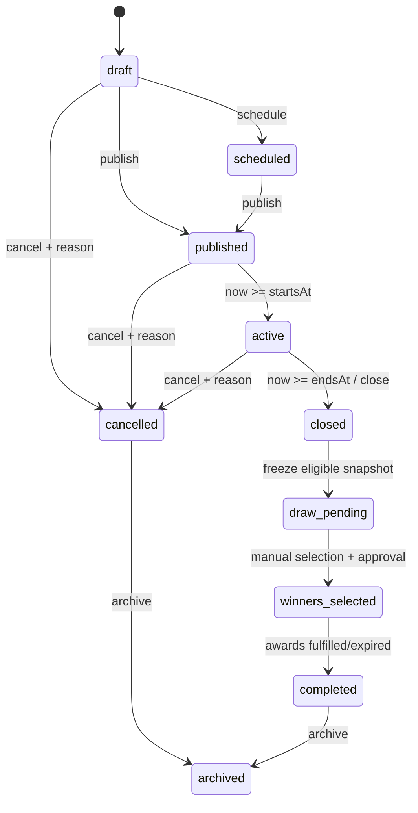

# P3 — اعتماد عقود النطاق وواجهات المستخدم

- **الإصدار:** P3.0
- **التاريخ والوقت:** 2026-10-20 04:12 (+03:00)
- **النموذج المنفذ:** Manus
- **المرجع:** قواعد P1 وتقرير P2 وخطة التنفيذ §§8، 10، 11، 14
- **الحالة:** معتمد تصميميًا؛ لا يحتوي هذا الملف على تنفيذ routes أو migrations.

## 1. حدود العقد

يكون `alx_api` مالك الهوية والصلاحية والملكية وقواعد الأهلية والمخزون والخصم والاسترداد. الواجهتان `SWIFTSHIP_SYSTEM` و`alx_web` تعرضان DTOs typed وتجمعان المدخلات فقط. لا تتصل الواجهة بقاعدة البيانات ولا تحسب خصمًا موثوقًا ولا تختار فائزًا.

كل استجابة تستخدم الغلاف الحالي `{ data, requestId }` عند النجاح، والغلاف الحالي للفشل مع `requestId` و`code` ورسالة آمنة. كل قائمة تستخدم `limit` و`offset` بحد أعلى 100، ولا تعرض PII أو بيانات تكلفة/ربح أو معرفات داخلية غير لازمة.

## 2. عقود موظفي النظام الأساسي

| الطريقة | المسار | الغرض | الحماية |
| --- | --- | --- | --- |
| GET | `/api/v1/features/contests` | قائمة المسابقات بفلاتر الحالة والفترة والبحث | `features.contests.read` |
| POST | `/api/v1/features/contests` | إنشاء مسودة | `features.contests.manage` |
| GET | `/api/v1/features/contests/:contestId` | تفاصيل المسابقة والعدادات والجوائز | `features.contests.read` |
| PATCH | `/api/v1/features/contests/:contestId` | تعديل مسموح حسب الحالة | `features.contests.manage` |
| POST | `/api/v1/features/contests/:contestId/transitions` | نشر/جدولة/إغلاق/إلغاء بسبب | `features.contests.manage` |
| GET | `/api/v1/features/contests/:contestId/entries` | مشاركات مصفحة بحد أدنى من الهوية | `features.contests.read` |
| POST | `/api/v1/features/contests/:contestId/entries/:entryId/review` | قبول/استبعاد مع سبب | `features.entries.review` |
| POST | `/api/v1/features/contests/:contestId/draw-runs` | فتح لقطة المؤهلين فقط | `features.draw.execute` |
| POST | `/api/v1/features/draw-runs/:drawRunId/execute` | تسجيل اختيار يدوي موثق في v1 | `features.draw.execute` |
| POST | `/api/v1/features/draw-runs/:drawRunId/approve` | اعتماد الفائزين وفصل المراجع | `features.winners.approve` |
| GET/POST/PATCH | `/api/v1/features/prizes` | كتالوج الجوائز والمخزون | `features.prizes.read/manage` |
| POST | `/api/v1/features/contests/:contestId/prizes` | ربط الجائزة وتخصيص كمية | `features.prizes.manage` |
| POST | `/api/v1/features/winner-awards/:awardId/fulfillment` | claim/fulfillment/shipped/delivered/expired | `features.prizes.fulfill` |
| GET/POST/PATCH | `/api/v1/features/coupons` | قواعد الكوبونات وحالاتها | `features.coupons.read/manage` |
| POST | `/api/v1/features/coupons/:couponId/issuances` | إصدار شخصي لفائز/عميل أو إصدار حملة | `features.coupons.manage` |
| POST | `/api/v1/features/coupon-issuances/:issuanceId/revoke` | سحب إصدار قبل الاسترداد بسبب | `features.coupons.revoke` |
| GET | `/api/v1/features/reports/summary` | تقارير مجمعة بلا PII زائد | `features.reports.read` |

### أجسام إدارية مختصرة

`ContestCreateInput` يحتوي `title`, `description`, `termsText`, `termsVersion`, `startsAt`, `endsAt`, `displayTimezone`, `entryPolicy`, `claimDays`, و`status=draft` فقط. لا يقبل `winner` أو `stock` كحقائق غير مرتبطة؛ الجوائز تربط عبر endpoint مستقل.

`ContestTransitionInput` يحتوي `action` من مجموعة مغلقة و`reason` عند `cancel`, `close`, أو إعادة فتح استثنائية، إضافة إلى `Idempotency-Key` في header. لا يقبل status نصيًا حرًا.

`ManualWinnerInput` يحتوي `entryId`, `contestPrizeId`, `selectionReason` و`reviewNote`، ويمنع اختيار مشاركة خارج snapshot أو غير مؤهلة. لا يحتوي اختيارًا عشوائيًا أو seed في v1.

`CouponRuleInput` يحتوي `codeMode`, `discountType`, `amount|percent`, `currencyCode` عند المبلغ الثابت، `minimumProductsSubtotal`, `maxDiscount`, `startsAt`, `endsAt`, `totalLimit`, `perCustomerLimit`, و`stacking=false`. لا يقبل `couponRate` أو `couponValue` كحقائق طلب.

## 3. عقود بوابة العميل

| الطريقة | المسار | الغرض |
| --- | --- | --- |
| GET | `/api/v1/portal/features/contests` | المسابقات المنشورة المرئية فقط |
| GET | `/api/v1/portal/features/contests/:contestId` | شروط ومواعيد وجوائز وحالة العميل الحالي |
| POST | `/api/v1/portal/features/contests/:contestId/entries` | مشاركة العميل المصادق وقبول الشروط |
| GET | `/api/v1/portal/features/me/entries` | مشاركات العميل وحالاتها المسموحة |
| GET | `/api/v1/portal/features/me/awards` | جوائز العميل ومواعيد المطالبة |
| POST | `/api/v1/portal/features/me/awards/:awardId/claim` | claim بإثبات الملكية وبيانات التسليم الضرورية فقط |
| GET | `/api/v1/portal/features/me/coupons` | كوبونات العميل وحالاتها |
| POST | `/api/v1/portal/coupons/validate` | quote للتحقق فقط، لا حجز ولا استهلاك |

كل مسار portal يستنتج `portalUserId` و`customerId` من access token والربط الحي. تغيير UUID في URL لا يغير نطاق الملكية، والاستجابة عند المورد غير المملوك آمنة ولا تكشف وجوده.

## 4. عقد انتقال couponRate إلى couponCode

العقد الجديد لطلب البوابة يستخدم:

```ts
interface PortalOrderCouponInput {
  couponCode?: string;
}

interface PortalOrderCreateInputV2 {
  // الحقول الحالية المعتمدة للطلب تبقى كما هي
  items: PortalOrderItemInput[];
  orderSourceId?: string;
  paymentCurrencyCode?: string;
  couponCode?: string;
}

interface PortalOrderQuoteDtoV2 {
  payableAmount: number;
  currency: { code: string; symbol: string };
  productsSubtotal: number;
  couponDeduction: number;
  totalWeight: number;
  totalCBM: number;
}
```

في الإصدار المتوافق لا يرسل العميل `couponEnabled`, `couponRate`, `couponValue`, أو أي مبلغ خصم. يرسل الرمز فقط، ويحل API القاعدة والإصدار والملكية والحدود، ثم يعيد `couponDeduction` المحسوب خادميًا. quote لا يحجز، وPOST create يعيد التحقق داخل معاملة واحدة.

مسار التوافق يمنع نشر واجهة V2 قبل نشر API V2. أثناء الانتقال، يقبل API القديم فقط خلف feature flag داخلي موثوق ومؤقت، ولا يبقى `couponRate` متاحًا لعميل البوابة العام. حقول `orders.coupon_enabled/rate/value` التاريخية الخاصة بكوبون شراء الشركة لا تتأثر.

## 5. الآلات والتدفقات

### المسابقة



### المشاركة والجائزة

المشاركة تمر `submitted → eligible|ineligible|disqualified`. بعد اعتماد النتيجة تنشأ جائزة مستقلة `assigned → notified → claimed → fulfillment_pending → shipped → delivered`. انتهاء المهلة يؤدي إلى `expired`. كل انتقال حساس يكتب audit/event ولا يحذف الحالة السابقة.

### الكوبون

التعريف يمر `draft → active → disabled|expired`. الإصدار يمر `issued → reserved → redeemed` أو `revoked|expired`; الفشل قبل redeem يحرر reservation بعكس idempotent. `validate` وquote قراءة/حساب فقط، ولا يزيدان عداد الاستخدام.

## 6. تجربة المستخدم المعتمدة

### بوابة العميل

يحتفظ المسار `/portal/customer/gifts`. يتحول المحتوى إلى أربع تبويبات: **المسابقات المتاحة، مشاركاتي، جوائزي، كوبوناتي**. تعرض المسابقة بطاقة حالة ومواعيد وشروطًا وإجراء مشاركة، ولا تعرض المشاركين أو التكلفة أو أسباب المراجعة الداخلية. تعرض «جوائزي» المهلة وخطوات claim، وتعرض «كوبوناتي» نوع الخصم والحد الأدنى والانتهاء والحالة مع زر نسخ/تطبيق دون كشف إصدار عميل آخر.

كل تبويب يملك حالات تحميل skeleton، فراغ، خطأ آمن، وانقطاع اتصال. RTL/LTR والجوال ولوحة المفاتيح والتركيز جزء من العقد، وليست قواعد أعمال داخل المكونات.

### النظام الأساسي

قسم مستقل باسم `featuresManagement` خارج `WebsiteManagementTabs`، بثلاثة مسارات واضحة: إدارة المسابقات، إدارة الجوائز، إدارة الكوبونات. كل شاشة تعرض permission-aware actions، pagination، تأكيدًا وسببًا للعمليات الحساسة، ولا تضع قواعد الخصم أو المخزون أو الفائزين داخل UI.

## 7. الأخطاء القياسية

| code | المعنى الآمن |
| --- | --- |
| `FEATURES_AUTH_REQUIRED` | تسجيل الدخول مطلوب |
| `FEATURES_FORBIDDEN` | لا تملك صلاحية الإجراء |
| `FEATURES_NOT_FOUND` | المورد غير موجود أو غير متاح |
| `CONTEST_NOT_OPEN` | المسابقة لا تقبل المشاركة |
| `CONTEST_ENTRY_EXISTS` | توجد مشاركة قائمة دون كشف بيانات إضافية |
| `CONTEST_TERMS_REQUIRED` | يلزم قبول شروط النسخة الحالية |
| `AWARD_NOT_CLAIMABLE` | الجائزة غير متاحة للمطالبة |
| `COUPON_INVALID_OR_UNAVAILABLE` | الكوبون غير صالح أو غير متاح |
| `COUPON_CURRENCY_MISMATCH` | عملة الكوبون لا تطابق الطلب |
| `COUPON_LIMIT_REACHED` | لا يمكن إتمام الاستخدام |
| `QUOTE_STALE` | تغيرت القاعدة، أعد التسعير |
| `IDEMPOTENCY_KEY_CONFLICT` | مفتاح التكرار مستخدم لعملية أخرى |
| `FEATURES_EMERGENCY_DISABLED` | الإصدار/الاستهلاك متوقف مؤقتًا |

لا تكشف هذه الأكواد وجود كوبون لعميل آخر أو حدًا إجماليًا سريًا أو سبب مكافحة إساءة الاستخدام.

## 8. قرارات P3 والحدود

- [x] endpoint shapes وDTOs وpagination وenvelope وrequest ID محددة.
- [x] state diagrams للمسابقة والمشاركة والجائزة والكوبون محددة.
- [x] UI flow للبوابة والنظام الأساسي محدد مع فصل Business Logic عن UI.
- [x] quote/redeem وقاعدة عدم الثقة في مبلغ المتصفح محددة.
- [x] انتقال `couponRate` إلى `couponCode` محدد دون المساس بكوبون الشركة الداخلي.
- [x] رسائل الأخطاء الآمنة محددة.
- [ ] لا يبدأ P4 قبل معالجة مانع RLS/grants المسجل في P2 واعتماد تصميم الجداول والقيود وRLS/GRANTs.

**المرحلة التالية:** P4 — تصميم Drizzle وDDL والمigrations ومراجعة الأمن، دون تطبيق على قاعدة مشتركة أو إنتاجية قبل dry-run وإذن صريح.
